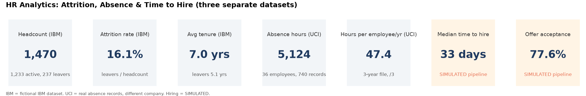
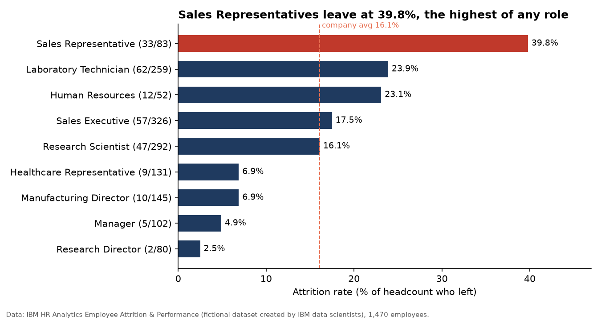
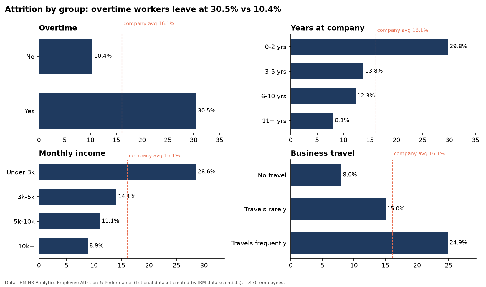
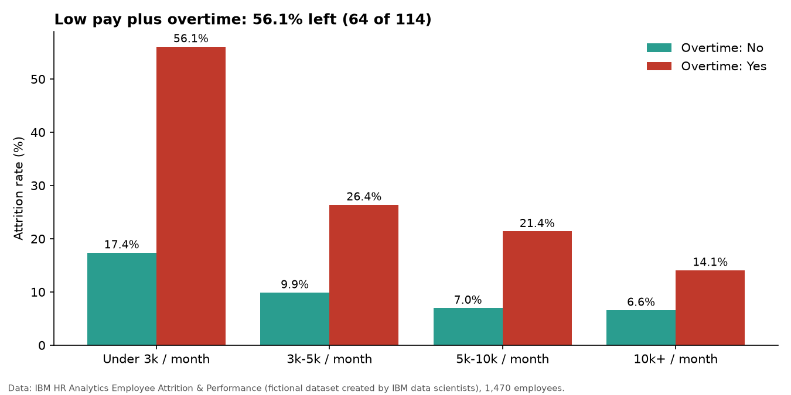
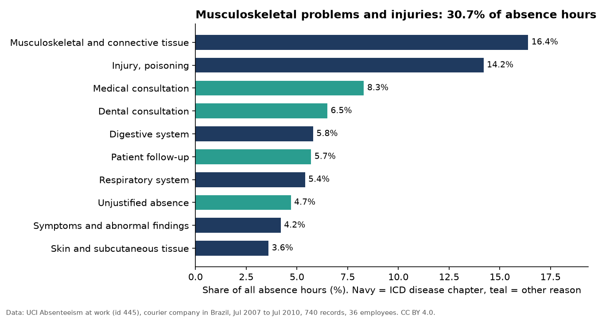
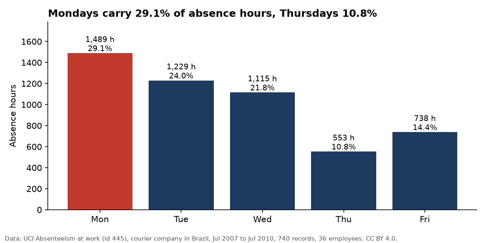
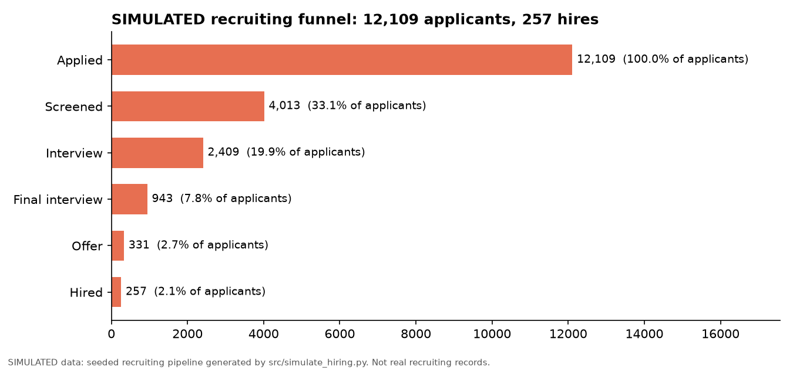
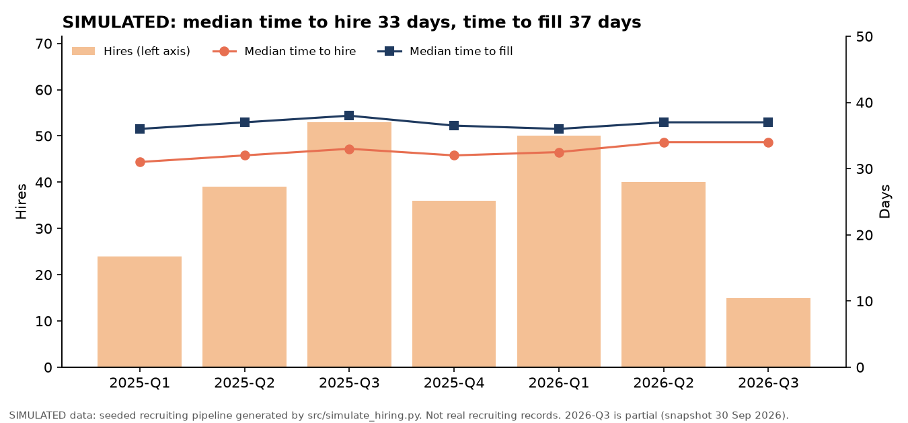
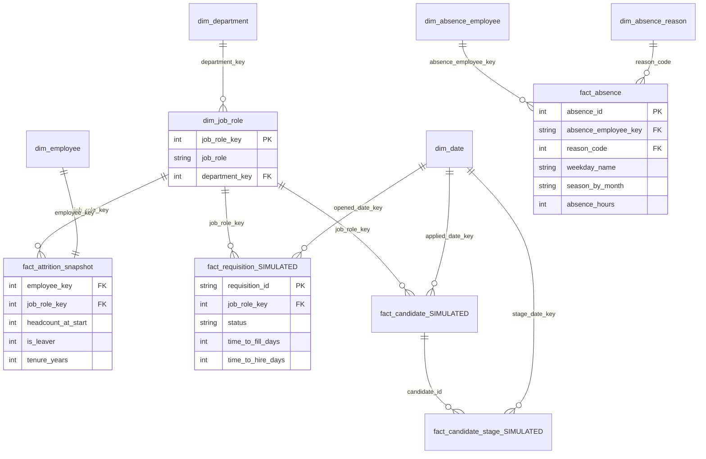
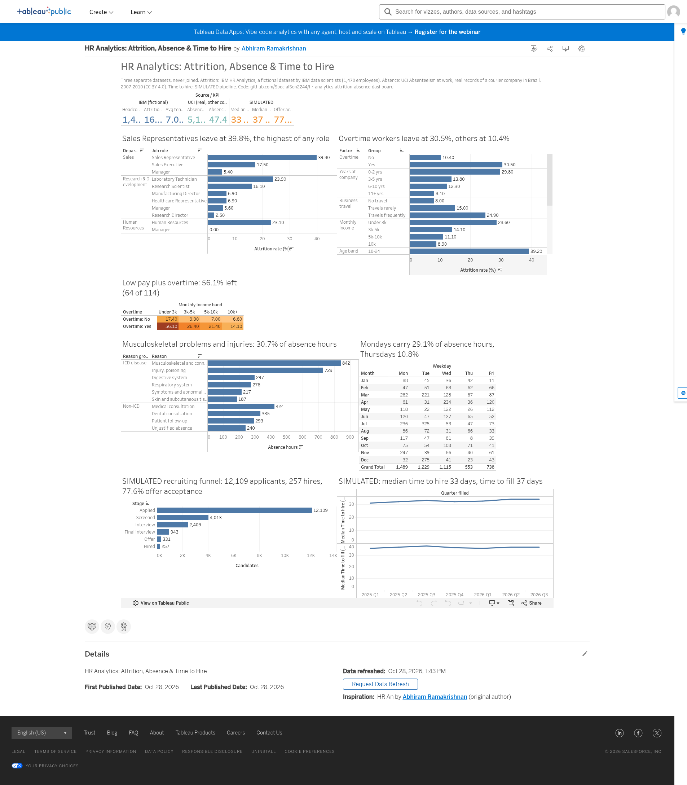

# 👥 HR Analytics: Attrition, Absence & Time to Hire

An end-to-end **people analytics** project: a DuckDB + Polars star schema built
from two public HR datasets and a clearly labelled simulated recruiting
pipeline, with a Tableau Public workbook spec, a Power BI model with DAX
measures, and the findings an HR business partner would ask for.

**Live dashboard (Tableau Public):** [HR Analytics: Attrition, Absence & Time to Hire](https://public.tableau.com/app/profile/abhiram.ramakrishnan3146/viz/HRAnalyticsAttritionAbsenceTimetoHire/Dashboard1) (build spec: [`tableau/BUILD_SPEC.md`](tableau/BUILD_SPEC.md)). Static previews below.

**Stack:** Python · DuckDB (SQL star schema) · Polars · openpyxl (Tableau-ready xlsx) · matplotlib · Tableau Public · Power BI (DAX) · Makefile

## Questions

1. **Workforce:** how many people, where, how long have they stayed?
2. **Attrition:** who leaves, and which factors go with higher attrition (overtime, role, tenure, pay, travel)?
3. **Absence:** why, when and how concentrated is absence? Who would a Bradford factor flag?
4. **Hiring:** how long does it take to fill a role and to hire, and which sources convert? *(SIMULATED data, see below)*

## Data and honesty notes

| Dataset | What it is | Rows | Licence | Used for |
|---|---|---|---|---|
| [IBM HR Analytics Employee Attrition & Performance](https://www.kaggle.com/datasets/pavansubhasht/ibm-hr-analytics-attrition-dataset), downloaded from IBM's public mirror [IBM/employee-attrition-aif360](https://github.com/IBM/employee-attrition-aif360/blob/master/data/emp_attrition.csv) | **Fictional data created by IBM data scientists.** One undated snapshot of 1,470 employees, 35 columns | 1,470 | ODbL 1.0 (database) / DbCL 1.0 (contents), as stated in the IBM repo | headcount, attrition |
| [UCI Absenteeism at work](https://archive.ics.uci.edu/dataset/445/absenteeism+at+work) (Martiniano & Ferreira, doi [10.24432/C5X882](https://doi.org/10.24432/C5X882)) | **Real** absence records of 36 employees of a courier company in Brazil, July 2007 to July 2010 | 740 | CC BY 4.0 | absence |
| `data/simulated/SIMULATED_*.csv` | **SIMULATED** recruiting pipeline from a seeded generator (`src/simulate_hiring.py`, seed 20261028). Departments and roles follow IBM's leavers; everything else is an assumption, documented in [`docs/simulated_hiring.md`](docs/simulated_hiring.md) | 300 requisitions, 12,109 candidates | MIT (generated here) | time to hire, time to fill, funnel |

- The IBM file is **not real employee data**. Its patterns are a well-known practice case, not evidence about IBM or any company.
- The three sources describe **three different organisations**. They are modelled side by side and never joined (IBM and the simulation only share IBM's three department names).
- The IBM snapshot has no dates and no termination type, so attrition is "share of the file that left", not an annual rate, and **voluntary attrition cannot be separated**.
- **Hiring numbers are SIMULATED.** They show how the metrics and dashboard work; differences between sources follow from the assumed rates.
- `src/download.py` checks row counts, column counts and SHA-256 hashes. The IBM file has 1,470 rows, 35 columns and 237 leavers, the known values of the Kaggle dataset.

## Key findings

IBM attrition (fictional data, 1,470 employees, 237 leavers):
- **Overall attrition 16.1%**. Sales 20.6%, HR 19.0%, R&D 13.8% (R&D is 65% of headcount).
- **Overtime: 30.5% left vs 10.4% without overtime**, about 2.9 times higher.
- **Overtime on low pay (under 3k a month): 56.1% left** (64 of 114).
- **Job role:** Sales Representatives 39.8%, Laboratory Technicians 23.9%; Research Directors 2.5%.
- **Tenure:** 29.8% of people in their first two years left, 8.1% after 11+ years. Average tenure 7.4 yrs (stayers) vs 5.1 (leavers).
- **Pay:** 28.6% attrition under 3k monthly income vs 8.9% at 10k+. **Travel:** frequent travellers 24.9% vs 8.0% for non-travellers.

UCI absence (real records, 36 employees, 3 years):
- **5,124 absence hours**, about **47 hours per employee per year**; the median absence is just 3 hours.
- **Musculoskeletal problems and injuries cause 30.7% of hours**; medical and dental appointments are 35% of records but 15% of hours.
- **Mondays carry 29.1% of absence hours, Thursdays 10.8%.**
- By season (Southern Hemisphere, from the month), autumn (Mar–May) has 32.1% of hours, summer 18.1%; March and July are the peak months.
- **5 employees account for 41% of all hours**; 12 of 36 have an annualised Bradford factor of 250+.

Hiring (**SIMULATED**): median **time to fill 37 days**, median **time to hire 33 days**, **offer acceptance 77.6%**, 2.1% of applicants hired.

Details: [`docs/findings.md`](docs/findings.md), all tables: [`docs/findings_results.md`](docs/findings_results.md).










## Data model



The absence tables (UCI) have no link to the IBM or SIMULATED tables: they are a different company.
`dim_job_role` is keyed on department + role (Manager exists in all three departments).

| Table | Rows | Grain |
|---|---|---|
| dim_department / dim_job_role / dim_employee | 3 / 11 / 1,470 | IBM department / department + job role / employee |
| fact_attrition_snapshot | 1,470 | employee at the snapshot (headcount, leaver flag, tenure) |
| dim_absence_employee / dim_absence_reason | 36 / 29 | courier employee / ICD or non-ICD reason |
| fact_absence | 740 | absence record (month, weekday, hours) |
| dim_date | 730 | day, 2025–2026 |
| fact_requisition / fact_candidate / fact_candidate_stage (SIMULATED) | 300 / 12,109 / 20,062 | requisition / applicant / applicant × stage |

## Method

1. `src/download.py` downloads both files with retries and validates rows, columns and hashes.
2. `src/simulate_hiring.py` writes the SIMULATED requisitions and candidates (seeded, reproducible).
3. `src/build.py` cleans with **Polars** (snake_case names, constant columns dropped) and runs [`sql/model.sql`](sql/model.sql) in **DuckDB** to build the star schema (`data/hr.duckdb`).
4. `src/validate.py` runs 23 data quality checks and writes [`docs/validation.md`](docs/validation.md).
5. `src/findings.py` runs the 26 named queries in [`sql/findings.sql`](sql/findings.sql) into `docs/findings_results.md` / `docs/findings.json`; `src/report.py` writes [`docs/findings.md`](docs/findings.md), with every number read from the JSON.
6. `src/charts.py` draws the 8 PNGs in `images/`.
7. `src/tableau_workbook.py` writes `tableau/hr_analytics_dashboard.xlsx` (one tidy sheet per chart, rates pre-computed, no calculated fields needed) and the same tables as `exports/*.csv`.
8. `src/export_powerbi.py` writes the star schema as 13 CSVs to `powerbi/model/`; `src/data_dictionary.py` writes [`docs/data_dictionary.md`](docs/data_dictionary.md).
9. `tests/verify_tableau_xlsx.py` re-reads the xlsx and checks 183 values against the findings.

| SQL | What it does |
|---|---|
| [`sql/model.sql`](sql/model.sql) | dimensions and facts for all three subject areas |
| [`sql/findings.sql`](sql/findings.sql) | named analysis queries (`-- name: f1_...`), IBM f1–f12, UCI f20–f26, SIMULATED f30–f35 |

## Dashboards

- **Tableau Public:** one dashboard, *HR Analytics: Attrition, Absence & Time to Hire*, with a band per subject area (KPI strip, attrition by role, drivers, overtime × income, absence by reason and by month/weekday, SIMULATED funnel and time to hire). Step-by-step build: [`tableau/BUILD_SPEC.md`](tableau/BUILD_SPEC.md). Data: [`tableau/hr_analytics_dashboard.xlsx`](tableau/hr_analytics_dashboard.xlsx) (CSV copies in [`exports/`](exports)).

  **Live dashboard (Tableau Public):** [HR Analytics: Attrition, Absence & Time to Hire](https://public.tableau.com/app/profile/abhiram.ramakrishnan3146/viz/HRAnalyticsAttritionAbsenceTimetoHire/Dashboard1)

  
- **Power BI:** [`powerbi/`](powerbi): model CSVs in [`powerbi/model/`](powerbi/model), [`RELATIONSHIPS.md`](powerbi/RELATIONSHIPS.md), [`measures.dax`](powerbi/measures.dax) (headcount, attrition rate, average tenure, absence hours and estimated absence rate, Bradford factor, time to hire and time to fill median/average, offer acceptance), [`PAGE_LAYOUT.md`](powerbi/PAGE_LAYOUT.md) and build steps with check numbers in [`powerbi/README.md`](powerbi/README.md). Metric definitions: [`docs/definitions.md`](docs/definitions.md).

## Run it

```bash
git clone https://github.com/SpecialSon2244/hr-analytics-attrition-absence-dashboard.git
cd hr-analytics-attrition-absence-dashboard
make setup   # venv + requirements
make all     # download, simulate, build, validate, findings, charts, tableau, powerbi, docs, test
```

Without `make`, run the same scripts in that order with `.venv/bin/python src/<script>.py` (see the [`Makefile`](Makefile)).
The raw files are downloaded (not committed); the SIMULATED data and all outputs (xlsx, CSVs, charts, docs) are committed, so you can open them without running anything. `data/hr.duckdb` is rebuilt locally.

## Limitations

- IBM data is fictional and a single snapshot: no hire or exit dates, so no monthly headcount trend, no annualised attrition and no voluntary/involuntary split.
- Attrition splits are associations; overtime, pay, age, tenure and job level overlap.
- UCI absence covers one small company (36 people) and has no year column; seasons are derived from the month because UCI's season code does not match the months in the file. Bradford factor is annualised over ~3 years.
- The hiring data is SIMULATED. It demonstrates the pipeline and metrics, not real recruiting performance.

## Repository layout

```
data/raw/            downloaded source files (gitignored)    data/simulated/  SIMULATED_*.csv
sql/model.sql        star schema                              sql/findings.sql named analysis queries
src/                 download, simulate, build, validate, findings, report, charts, tableau_workbook, export_powerbi, data_dictionary
tableau/             hr_analytics_dashboard.xlsx, BUILD_SPEC.md
exports/             Tableau-ready CSVs                       powerbi/         model CSVs + DAX + relationships + layout + steps
docs/                findings, validation, definitions, simulated hiring, data dictionary   images/  README charts
tests/               verify_tableau_xlsx.py
```

## Licence

Code: MIT. IBM data: ODbL 1.0 / DbCL 1.0 (per [IBM/employee-attrition-aif360](https://github.com/IBM/employee-attrition-aif360)). UCI data: CC BY 4.0, Martiniano, A. & Ferreira, R. (2012), *Absenteeism at work*, UCI Machine Learning Repository, https://doi.org/10.24432/C5X882.
