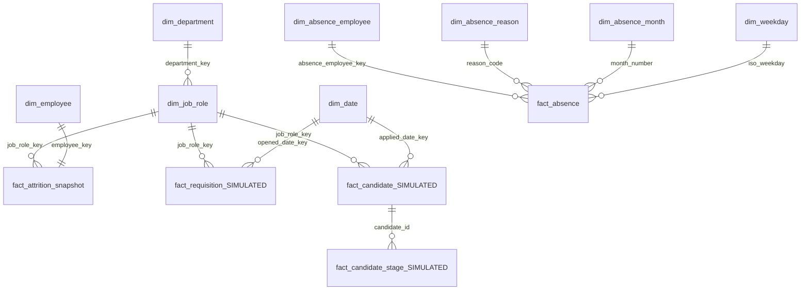

# Power BI model: tables and relationships

Load every CSV in `powerbi/model/` (Get Data, Text/CSV, or Folder). All relationships are
**many-to-one, single direction** (dimension filters fact) unless noted.

Three separate subject areas. **There are no relationships between them**, except the shared
IBM department / job role dimensions used by the IBM and SIMULATED tables. The UCI absence
tables stand alone: they describe a different company.

| # | From (many) | To (one) | Key | Active | Notes |
|---|---|---|---|---|---|
| 1 | dim_job_role[department_key] | dim_department[department_key] | department_key | yes | Snowflake: department filters job roles, job roles filter the facts |
| 2 | fact_attrition_snapshot[job_role_key] | dim_job_role[job_role_key] | job_role_key | yes | |
| 3 | fact_attrition_snapshot[employee_key] | dim_employee[employee_key] | employee_key | yes | One-to-one. Set cross filter to Single (dim_employee filters the fact) |
| 4 | fact_requisition_SIMULATED[job_role_key] | dim_job_role[job_role_key] | job_role_key | yes | |
| 5 | fact_candidate_SIMULATED[job_role_key] | dim_job_role[job_role_key] | job_role_key | yes | |
| 6 | fact_requisition_SIMULATED[opened_date_key] | dim_date[date_key] | date | yes | |
| 7 | fact_requisition_SIMULATED[closed_date_key] | dim_date[date_key] | date | **no** | Use with USERELATIONSHIP (measure "Hires by Fill Date") |
| 8 | fact_candidate_SIMULATED[applied_date_key] | dim_date[date_key] | date | yes | |
| 9 | fact_candidate_stage_SIMULATED[candidate_id] | fact_candidate_SIMULATED[candidate_id] | candidate_id | yes | Candidate filters its stages |
| 10 | fact_absence[absence_employee_key] | dim_absence_employee[absence_employee_key] | key | yes | |
| 11 | fact_absence[reason_code] | dim_absence_reason[reason_code] | reason_code | yes | |
| 12 | fact_absence[month_number] | dim_absence_month[month_number] | month_number | yes | |
| 13 | fact_absence[iso_weekday] | dim_weekday[iso_weekday] | iso_weekday | yes | |

Do **not** create relationships from the facts' `department_key` columns to
`dim_department`: department reaches the facts through `dim_job_role` (relationship 1),
and a second path would be ambiguous. Hide the `department_key` columns in the fact tables.

Do not relate `fact_candidate_stage_SIMULATED[stage_date_key]` to `dim_date` unless you
need stage dates by month; if you do, make it inactive.

## Column settings

- `dim_date[date]`: mark `dim_date` as date table (Table tools, Mark as date table, `date`).
- Sort by column: `dim_date[month_name]` by `month`, `dim_date[weekday_name]` by `iso_weekday`,
  `dim_absence_month[month_name]` by `month_number`, `dim_weekday[weekday_name]` by `iso_weekday`,
  `fact_candidate_stage_SIMULATED[stage]` by `stage_order`.
- `dim_employee[income_band]`, `[tenure_band]` have a sortable "1. " prefix. Either keep it or
  add a column without it and sort by the original.
- Data types: `*_date` columns Date; `*_date_key` Whole number; `is_*` True/False;
  `monthly_income` Whole number (no currency in the source, so do not apply a currency format).
- Hide technical keys (`*_key`, `is_simulated`) in report view.
